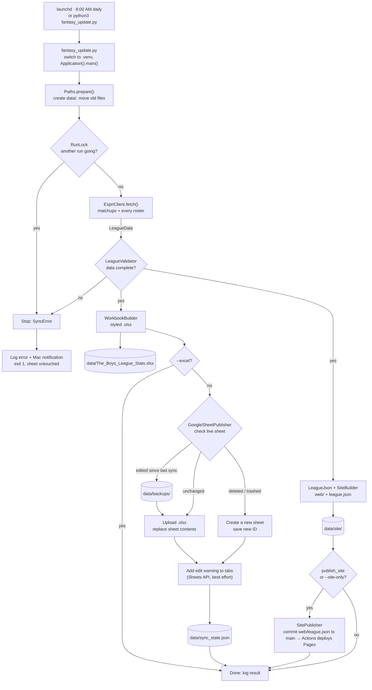

# Architecture



Back to the [README](../README.md) · See also [Setup](SETUP.md)

## How a run works

1. **Start.** launchd runs `fantasy_update.py` at 8:00 AM, or you run it by hand. If `.venv/`
   exists, the script restarts itself with the `.venv` Python so the right packages load.
2. **Prepare.** `Paths.prepare()` creates `data/` and moves files that older versions left in
   the project folder.
3. **Lock.** `RunLock` creates `data/.update.lock` holding the process ID. A second run stops
   with a message. A lock left by a crashed run, or one older than 6 hours, is cleared.
4. **Fetch.** `EspnClient` loads the league once, which includes every team's roster. It then
   reads the scoreboard and box scores for each matchup period up to the current one.
5. **Validate.** `LeagueValidator` refuses data that looks incomplete. If it fails, nothing is
   written and the Google Sheet is left alone.
6. **Build.** `WorkbookBuilder` writes the styled workbook to a temp file and renames it to
   `data/The_Boys_League_Stats.xlsx`.
7. **Publish** (skipped with `--excel`). `GoogleSheetPublisher` checks the live sheet:
   - edited since the last sync → download a backup to `data/backups/` first (if that fails, stop)
   - deleted, trashed or no longer a Sheet → create a new one and notify you to re-share it
   - no edit access → stop

   Then it uploads the `.xlsx`, which Drive converts to the Google Sheet, adds the edit warning
   to each tab, and records the sheet's `modifiedTime` in `data/sync_state.json`.
8. **Build the website.** `LeagueJson` uses `LeagueStats` to compute the same ranks and totals
   the sheet's formulas show; `SiteBuilder` copies `web/` and writes `league.json` into `data/site/`.
9. **Publish the website** (when `publish_site` is `true` or with `--site-only`; never with
   `--excel` or `--no-site`). `SitePublisher` keeps a detached checkout of `main` in
   `data/site-deploy/` (so it never touches your working branch), copies the new `league.json` to
   `web/league.json`, commits only that file and pushes to `main`. Nothing is committed when only the
   timestamp changed; if someone else pushed meanwhile, it rebuilds on top and tries once more. The
   **Deploy website** workflow (`.github/workflows/pages.yml`) then deploys `web/` to GitHub Pages. Google and the website
   are published independently: if one fails, the other still runs, and the run reports the failure.
10. **Report.** Success or failure goes to `data/update.log`. Failures also show a Mac notification.

## Code layout

One class per file, and each file is named after its class (`LeagueStats` → `league_stats.py`,
`SortableTable` → `sortable-table.js`).

```
fantasy_update.py                 entry point: .venv switch, then Application(root).main()
nbafantasy/
├── app/
│   ├── application.py            Application (singleton): paths, run lock, logging, failure alerts
│   ├── sync_pipeline.py          SyncPipeline: the steps of a run (fetch, build, publish)
│   └── run_options.py            RunOptions: the command-line flags
├── common/
│   ├── singleton.py              Singleton: metaclass, one instance per process
│   ├── sync_error.py             SyncError: a known problem that stops the run
│   ├── logger.py                 Logger (singleton): the run's log
│   ├── mac_notifier.py           MacNotifier (singleton): macOS notifications
│   ├── files.py                  Files: atomic write, read
│   ├── retry_policy.py           RetryPolicy: retries temporary errors
│   └── run_lock.py               RunLock: stops two runs overlapping
├── config/
│   ├── paths.py                  Paths: where every file lives
│   └── config.py                 Config: the contents of config.json
├── models/
│   ├── categories.py             Categories: the 9 scoring categories and player stats
│   ├── league_data.py            LeagueData
│   ├── week.py                   Week
│   ├── matchup_row.py            MatchupRow
│   ├── team_roster.py            TeamRoster
│   └── player.py                 Player
├── espn/
│   ├── espn_client.py            EspnClient: ESPN -> LeagueData
│   └── league_validator.py       LeagueValidator: data checks before anything is replaced
├── stats/
│   ├── ranking.py                Ranking: tie-aware ranks ("1, 2, 2, 4")
│   ├── league_stats.py           LeagueStats: weekly ranks and season totals
│   ├── weekly_row.py             WeeklyRow
│   └── season_row.py             SeasonRow
├── workbook/
│   ├── workbook_builder.py       WorkbookBuilder: the whole .xlsx
│   ├── theme.py                  Theme: fonts, colors, borders
│   ├── sheet_writer.py           SheetWriter: base class for a tab
│   ├── season_totals_sheet.py    SeasonTotalsSheet
│   ├── weekly_stats_sheet.py     WeeklyStatsSheet
│   └── team_roster_sheet.py      TeamRosterSheet
├── google_sheets/
│   ├── google_sheet_publisher.py GoogleSheetPublisher: .xlsx -> the shared Google Sheet
│   ├── google_auth.py            GoogleAuth: the saved Google login
│   ├── sync_state.py             SyncState: when the sheet was last written
│   ├── sheet_check.py            SheetCheck: what the live sheet looks like before an update
│   └── sheet_publish_result.py   SheetPublishResult
└── website/
    ├── league_json.py            LeagueJson: what goes into league.json
    ├── site_builder.py           SiteBuilder: web/ + league.json -> data/site/
    ├── site_publisher.py         SitePublisher: league.json -> web/league.json on main
    └── site_publish_result.py    SitePublishResult
web/
├── index.html, style.css         the page and its styles
└── js/                           ES modules, one class each (see "Website" below); main.js starts the app
tests/                            one test file per class (test_league_stats.py, ...); sample_league.py
                                  holds SampleLeague, a made-up league for tests
scripts/                          install.sh (venv + login + launchd), uninstall.sh
.github/workflows/pages.yml       deploys web/ to GitHub Pages when it changes on main
.githooks/pre-commit              blocks commits of private files and secrets
```

Each step is a class that receives what it needs (`Config`, `Paths`, `RetryPolicy`) in its
constructor, and steps exchange only the plain data objects in `models/`. There are no
module-level functions: helpers are static methods on a class (`Files`, `Ranking`).

**Singletons.** Classes that must exist once per process use the `Singleton` metaclass:
`Logger` (the one log stream), `MacNotifier` and `Application`. Calling the class returns the same
instance every time; `reset()` exists for tests. Data and settings (`Paths`, `Config`) are
deliberately *not* singletons, so tests can build them with different values.

**Website (`web/js/`)** follows the same layout with ES modules, one class per file:

| File | Class | Role |
|---|---|---|
| `util/dom.js`, `util/format.js`, `util/rank-color.js` | `Dom`, `Format`, `RankColor` | Stateless helpers (static methods): building elements, number formats, rank colors |
| `state/preferences.js` | `Preferences` (singleton) | The viewer's Stats/Ranks choice, kept in `localStorage` |
| `state/league.js` | `League` (singleton) | Loads `league.json` and answers lookups (team colors, standings, a team's history) |
| `components/widgets.js` | `Widgets` | Shared pieces: team name with color dot, result badges, the Stats/Ranks switch |
| `components/sortable-table.js` | `SortableTable` | A table whose columns sort on click; remembers each table's sort |
| `pages/page.js` → `season-page.js`, `weekly-page.js`, `team-page.js` | `Page` → `SeasonPage`, `WeeklyPage`, `TeamPage` | One class per page; the base class builds the category columns |
| `router.js` | `Router` | Maps `#/season`, `#/weekly/<n>`, `#/team/<name>` to a page |
| `app.js` | `App` (singleton) | Loads the data, draws the header, starts the router |
| `main.js` | (none) | Entry point: `App.instance().start()` |

The JavaScript singletons are created with `X.instance()`; calling `new X()` a second time throws.

## Data model

| Class | Holds |
|---|---|
| `LeagueData` | `teams` (ESPN order), `weeks`, `rosters` (team name → `TeamRoster`), `my_team` |
| `Week` | `number`, `final` (finished or in progress), `rows` |
| `MatchupRow` | One team's side of a matchup: opponent, category W/L/T, result (`W`/`L`/`T`/`Live`), the 9 category stats |
| `TeamRoster` | A team's `players`, sortable into lineup order |
| `Player` | Lineup slot, name, NBA team, positions, injury status, season per-game averages |

The league uses 9-category head-to-head scoring: FG%, FT%, 3PM, REB, AST, STL, BLK, TO, PTS.
For TO, fewer is better.

## Sheet tabs

| Tab | Class | Contents |
|---|---|---|
| Season Totals | `SeasonTotalsSheet` | Record, category W/L/T, season stats and league rank per category. All formulas over Weekly Stats. |
| Weekly Stats | `WeeklyStatsSheet` | Every team's matchup each week, its 9 stats, and its rank that week. The week in progress shows `Live`. |
| *Team name* (one per team) | `TeamRosterSheet` | Current roster with season averages. Your team first with a green tab; other tabs use the team's color. |

Season FG% and FT% are the average of the weekly percentages. On roster tabs, FG% and FT% are
formulas (made ÷ attempted). Tab names are cleaned to meet Google's rules: no `[]:*?/\`,
at most 31 characters, and unique.

## Website

`league.json` (schema version 1) holds `teams` (name, color), `season` (record, category record,
stats, league ranks, average rank, weeks played, and `per_week` averages with their own league
ranks), `season_completed` (the same, from finished weeks only), `weeks` (each team's matchup row with stats, weekly ranks,
average and overall rank) and `rosters` (players in lineup order with per-game averages and
FG%/FT% as made ÷ attempted). It is built from an allow-list of fields, so nothing from
`config.json` can reach it.

`web/js/` loads it and renders three hash-routed pages: `#/season`, `#/weekly/<n>` and
`#/team/<name>`. Every table sorts by any column; category cells are tinted by rank (green = 1st,
red = last) and a Stats/Ranks switch shows values or ranks. The Season page also has a
Total/Per week switch (season sums, or `per_week` averages and ranks, which are fair to teams
that had a bye) and, while a week is in progress, an Include/Exclude switch that shows `season` or
`season_completed`. Every switch is remembered per viewer in `localStorage`. The page uses no libraries or build step; the browser loads the ES modules directly.

`LeagueStats` mirrors the workbook formulas (and also builds `season_completed`, which leaves the
week in progress out of everything): weekly rank = 1 + teams strictly better that week
(TO: fewer is better), overall = rank of the average category rank, season W/L/T counts finished
weeks only, category record and counting stats sum every week, FG%/FT% average the weekly
percentages, and league rank uses the same tie rule ("1, 2, 2, 4").

## Safety checks

| Situation | What happens |
|---|---|
| ESPN data incomplete | Validation fails and nothing changes. Checks: at least 2 teams; 2 rows per matchup in each finished week (one bye allowed when the team count is odd); category scores add up to 9; every team has a roster; `my_team_name` exists. |
| Someone edited the sheet | Detected by comparing `modifiedTime` with `data/sync_state.json`. A backup goes to `data/backups/` (last 20 kept) before replacing. If the backup fails, the run stops. |
| Sheet deleted or trashed | A new sheet is created, `data/sheet_id.txt` is updated, and you're notified to re-share. |
| Lost edit access | The run stops; nothing changes. |
| Temporary errors | Up to 3 tries with growing waits for network errors, Google 429/5xx and rate-limit 403s. ESPN login errors and other 4xx errors fail immediately. |
| Website publish fails | Logged and notified; the Google Sheet update still happens (and the other way round). The run exits with an error. |
| Website unchanged | No commit and no push. |
| Crash mid-write | The token, sheet ID, state and `.xlsx` are written to a temp file and then renamed, so they're never left half-written. |

## External services

| Service | Used for | Access |
|---|---|---|
| ESPN Fantasy API (`espn-api` package) | League, matchups, box scores, rosters | `espn_s2` + `SWID` cookies |
| Google Drive API v3 | Upload/convert the sheet, check it, export backups | OAuth, `drive.file` scope (only files this app created) |
| Google Sheets API v4 | Edit-warning protection on each tab (optional) | Same OAuth login |
| GitHub (git push) + GitHub Actions + Pages | The run pushes `web/league.json` to `main`; the **Deploy website** workflow publishes `web/` | Your existing git login; the workflow uses GitHub's built-in Pages token |
| macOS launchd / osascript | Daily schedule / notifications | Local |

## Design decisions

- **Replace the whole sheet each run** instead of editing cells. Every run produces a complete,
  consistent sheet, and the formulas and styling come from one place (`workbook/`). The cost is
  that manual edits are overwritten, which is why edits are backed up and tabs carry a warning.
- **Formulas instead of computed numbers** in Season Totals and the rank columns, so the sheet
  shows how each number is derived and recalculates if a value is corrected.
- **The website is static and built by the same run**, so it reuses the validated data, needs no
  server, and the ESPN cookies stay on the Mac. See [WEBSITE_PLAN.md](WEBSITE_PLAN.md) for later phases.
- **Everything on `main`.** The site's code and its data (`web/league.json`) live on one branch;
  a data commit is added only when the numbers change. New work happens on working branches merged
  into `main`. GitHub Actions deploys `web/`, so no separate site branch is needed.
- **`drive.file` scope only**: the app can't see anything else in your Drive.
- **Files you provide vs. files the app writes**: `config.json` and `credentials.json` sit in the
  project folder; everything generated lives in `data/`. Both are git-ignored.
