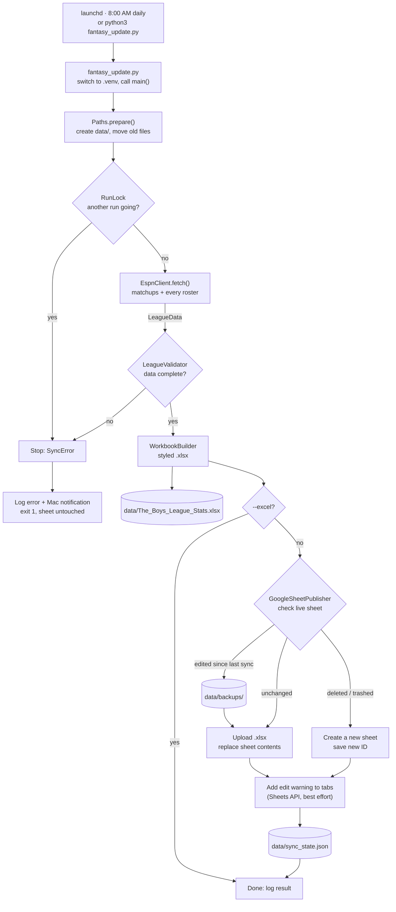

# Architecture



Back to the [README](../README.md) · See also [Setup](SETUP.md)

## How a run works

1. **Start.** launchd runs `fantasy_update.py` at 8:00 AM, or you run it by hand. If `.venv/`
   exists, the script restarts itself with the `.venv` Python so the right packages load.
2. **Prepare.** `Paths.prepare()` creates `data/` and moves files that older versions left in
   the project folder.
3. **Lock.** `RunLock` creates `data/.update.lock` holding the process ID. A second run stops
   with a message. A lock left by a crashed run, or one older than 6 hours, is cleared.
4. **Fetch.** `EspnClient` loads the league once, which includes every team's roster. It then
   reads the scoreboard and box scores for each matchup period up to the current one.
5. **Validate.** `LeagueValidator` refuses data that looks incomplete. If it fails, nothing is
   written and the Google Sheet is left alone.
6. **Build.** `WorkbookBuilder` writes the styled workbook to a temp file and renames it to
   `data/The_Boys_League_Stats.xlsx`.
7. **Publish** (skipped with `--excel`). `GoogleSheetPublisher` checks the live sheet:
   - edited since the last sync → download a backup to `data/backups/` first (if that fails, stop)
   - deleted, trashed or no longer a Sheet → create a new one and notify you to re-share it
   - no edit access → stop

   Then it uploads the `.xlsx`, which Drive converts to the Google Sheet, adds the edit warning
   to each tab, and records the sheet's `modifiedTime` in `data/sync_state.json`.
8. **Report.** Success or failure goes to `data/update.log`. Failures also show a Mac notification.

## Code layout

```
fantasy_update.py        Entry point: .venv switch, then nbafantasy.app.main()
nbafantasy/
├── app.py               SyncApp, main()          wires the steps together; CLI flags
├── config.py            Paths, Config            file locations; config.json
├── models.py            LeagueData, Week, MatchupRow, TeamRoster, Player
├── espn_client.py       EspnClient               ESPN -> LeagueData
├── validation.py        LeagueValidator          data checks before anything is replaced
├── workbook.py          WorkbookBuilder + one SheetWriter subclass per tab
├── google_sync.py       GoogleAuth, SyncState, GoogleSheetPublisher
├── lock.py              RunLock
├── util.py              RetryPolicy, MacNotifier, log, write_file
└── errors.py            SyncError
scripts/                 install.sh (venv + login + launchd), uninstall.sh
.githooks/pre-commit     blocks commits of private files and secrets
```

Each step is a class that receives what it needs (`Config`, `Paths`, `RetryPolicy`) in its
constructor, and steps exchange only the plain data objects in `models.py`.

## Data model

| Class | Holds |
|---|---|
| `LeagueData` | `teams` (ESPN order), `weeks`, `rosters` (team name → `TeamRoster`), `my_team` |
| `Week` | `number`, `final` (finished or in progress), `rows` |
| `MatchupRow` | One team's side of a matchup: opponent, category W/L/T, result (`W`/`L`/`T`/`Live`), the 9 category stats |
| `TeamRoster` | A team's `players`, sortable into lineup order |
| `Player` | Lineup slot, name, NBA team, positions, injury status, season per-game averages |

The league uses 9-category head-to-head scoring: FG%, FT%, 3PM, REB, AST, STL, BLK, TO, PTS.
For TO, fewer is better.

## Sheet tabs

| Tab | Class | Contents |
|---|---|---|
| Season Totals | `SeasonTotalsSheet` | Record, category W/L/T, season stats and league rank per category. All formulas over Weekly Stats. |
| Weekly Stats | `WeeklyStatsSheet` | Every team's matchup each week, its 9 stats, and its rank that week. The week in progress shows `Live`. |
| *Team name* (one per team) | `TeamRosterSheet` | Current roster with season averages. Your team first with a green tab; other tabs use the team's color. |

Season FG% and FT% are the average of the weekly percentages. On roster tabs, FG% and FT% are
formulas (made ÷ attempted). Tab names are cleaned to meet Google's rules: no `[]:*?/\`,
at most 31 characters, and unique.

## Safety checks

| Situation | What happens |
|---|---|
| ESPN data incomplete | Validation fails and nothing changes. Checks: at least 2 teams; 2 rows per matchup in each finished week (one bye allowed when the team count is odd); category scores add up to 9; every team has a roster; `my_team_name` exists. |
| Someone edited the sheet | Detected by comparing `modifiedTime` with `data/sync_state.json`. A backup goes to `data/backups/` (last 20 kept) before replacing. If the backup fails, the run stops. |
| Sheet deleted or trashed | A new sheet is created, `data/sheet_id.txt` is updated, and you're notified to re-share. |
| Lost edit access | The run stops; nothing changes. |
| Temporary errors | Up to 3 tries with growing waits for network errors, Google 429/5xx and rate-limit 403s. ESPN login errors and other 4xx errors fail immediately. |
| Crash mid-write | The token, sheet ID, state and `.xlsx` are written to a temp file and then renamed, so they're never left half-written. |

## External services

| Service | Used for | Access |
|---|---|---|
| ESPN Fantasy API (`espn-api` package) | League, matchups, box scores, rosters | `espn_s2` + `SWID` cookies |
| Google Drive API v3 | Upload/convert the sheet, check it, export backups | OAuth, `drive.file` scope (only files this app created) |
| Google Sheets API v4 | Edit-warning protection on each tab (optional) | Same OAuth login |
| macOS launchd / osascript | Daily schedule / notifications | Local |

## Design decisions

- **Replace the whole sheet each run** instead of editing cells. Every run produces a complete,
  consistent sheet, and the formulas and styling come from one place (`workbook.py`). The cost is
  that manual edits are overwritten, which is why edits are backed up and tabs carry a warning.
- **Formulas instead of computed numbers** in Season Totals and the rank columns, so the sheet
  shows how each number is derived and recalculates if a value is corrected.
- **`drive.file` scope only**: the app can't see anything else in your Drive.
- **Files you provide vs. files the app writes**: `config.json` and `credentials.json` sit in the
  project folder; everything generated lives in `data/`. Both are git-ignored.
